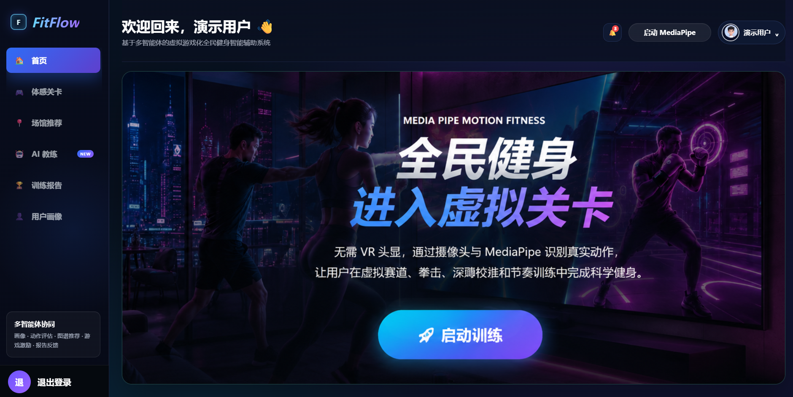
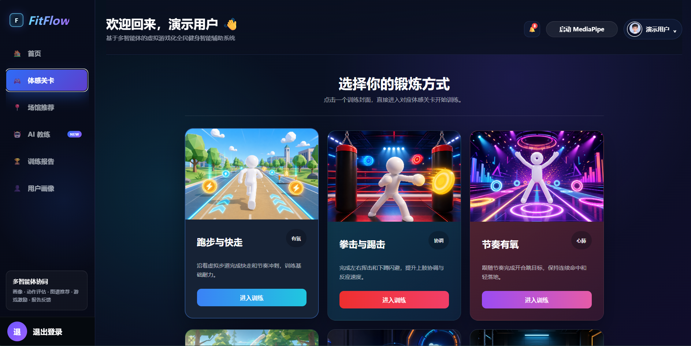
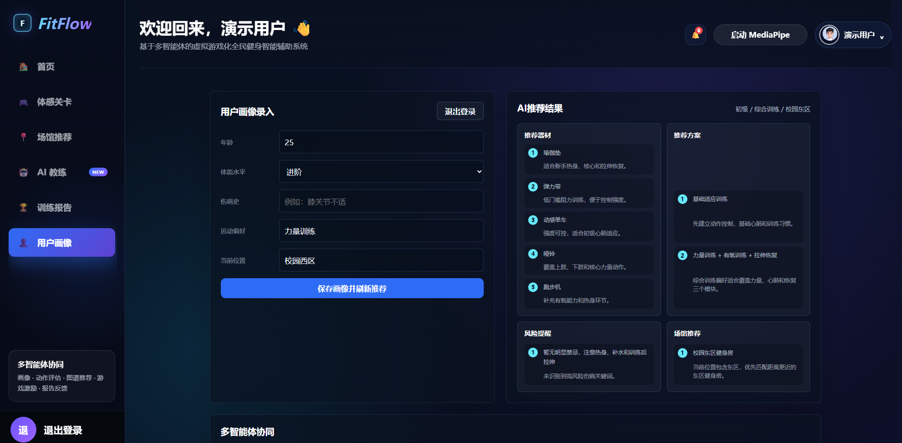
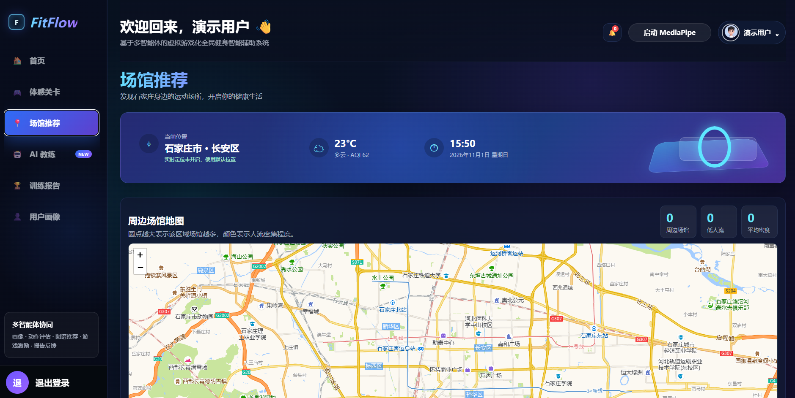
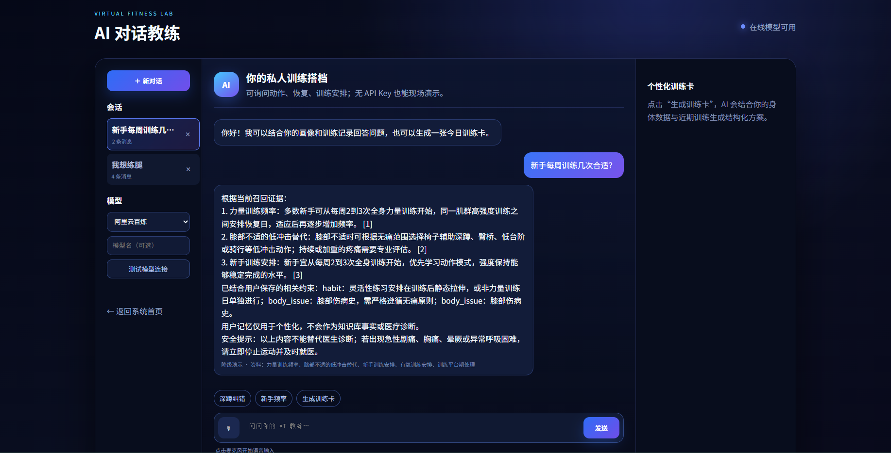

# 基于多智能体的虚拟游戏化全民健身智能辅助系统

面向校园、社区和全民健身场景的 Web 应用原型，围绕用户画像、智能健身建议、游戏化训练、场馆推荐和训练反馈构建服务闭环。项目后端使用 FastAPI，前端为原生 HTML/CSS/JavaScript；可按需接入大语言模型、向量检索、Neo4j、Redis 和 PostgreSQL。

## 功能概览

- 用户注册、登录、身体与运动画像管理，以及 JWT 身份认证。
- 多智能体工作流，覆盖画像分析、动作评估、训练推荐、激励和报告。
- 摄像头体感训练与 MediaPipe 姿态评估，并支持键盘演示和训练记录。
- 场馆地图及推荐，结合位置、器材、环境和人流等信息。
- 积分、等级、关卡和徽章等游戏化反馈；用户训练历史与报告。
- AI 对话教练，支持多轮会话、个性化训练建议、动作纠错及知识检索。
- 管理端用于查看运营数据、管理用户、课程、场馆、器材和知识图谱。
- OpenAPI/Swagger 接口文档、训练 WebSocket 和健康检查接口。

## 界面预览

| 首页 | 体感训练关卡 |
| --- | --- |
|  |  |

| 用户画像与 AI 推荐 | 场馆地图与推荐 |
| --- | --- |
|  |  |

AI 对话教练：



## 环境要求

- Python 3.12（Docker 镜像使用 Python 3.12）。
- pip。
- 摄像头识别建议使用最新版 Chrome 或 Edge，并通过 `localhost` 或 HTTPS 访问。
- AI 对话和在线模型能力需要相应服务商的 API Key；没有 Key 时应用可使用降级演示能力。
- Neo4j、Redis、PostgreSQL 均为可选集成；按 `.env` 中的连接配置启用。

## 本地运行

在仓库根目录执行以下命令。Windows PowerShell：

```powershell
py -3.12 -m venv .venv
.\.venv\Scripts\Activate.ps1
python -m pip install --upgrade pip
python -m pip install -r requirements.txt
Copy-Item .env.example .env
```

macOS / Linux：

```bash
python3.12 -m venv .venv
source .venv/bin/activate
python -m pip install --upgrade pip
python -m pip install -r requirements.txt
cp .env.example .env
```

编辑 `.env`，至少将 `JWT_SECRET` 改为随机且足够长的密钥。`.env.example` 默认使用本地 SQLite 数据库，不需要先安装数据库服务。然后启动：

```bash
uvicorn app.main:app --host 127.0.0.1 --port 8765 --reload
```

在浏览器打开 <http://127.0.0.1:8765/>。应用启动时会初始化数据库表和基础数据；如要验证服务状态，可访问 <http://127.0.0.1:8765/health>。

其他本地地址：

- AI 对话教练：<http://127.0.0.1:8765/ai-coach>
- Swagger API 文档：<http://127.0.0.1:8765/docs>
- ReDoc：<http://127.0.0.1:8765/redoc>
- OpenAPI JSON：<http://127.0.0.1:8765/openapi.json>

## 配置

配置项集中在 `.env.example`。服务启动时会读取仓库根目录 `.env`；已有的进程环境变量优先于文件中的值。

| 配置 | 用途 | 本地默认行为 |
| --- | --- | --- |
| `JWT_SECRET` | 签发和验证登录令牌 | 示例值仅供本地开发，部署前必须更换 |
| `DATABASE_URL` | SQLAlchemy 数据库连接 | SQLite：`sqlite:///fitness.db` |
| `REDIS_URL` | 缓存和限流 | Redis 不可用时相关能力降级 |
| `LLM_PROVIDER`、`MODEL_NAME` | 默认模型服务商和模型 | 可选 `deepseek` 或 `dashscope` |
| `DEEPSEEK_API_KEY`、`DASHSCOPE_API_KEY` | 大模型 API 凭证 | 留空时使用降级演示能力 |
| `NEO4J_URI`、`NEO4J_USERNAME`、`NEO4J_PASSWORD` | 知识图谱数据库连接 | Neo4j 不可用时图谱能力不可用，核心页面仍可运行 |
| `EMBEDDING_*`、`CHROMA_PERSIST_DIRECTORY` | 本地嵌入模型和向量检索 | 默认优先本地加载；是否允许下载由配置控制 |
| `OBSERVABILITY_*` | Langfuse/LangSmith 等观测配置 | 默认关闭 |

使用 DeepSeek 时，在 `.env` 中设置：

```env
LLM_PROVIDER=deepseek
MODEL_NAME=deepseek-chat
DEEPSEEK_API_KEY=你的密钥
```

使用阿里云百炼兼容接口时：

```env
LLM_PROVIDER=dashscope
MODEL_NAME=qwen-plus
DASHSCOPE_API_KEY=你的密钥
```

不要将 `.env`、真实 API Key、生产 JWT 密钥或数据库密码提交到版本库。生产或共享部署时，请使用单独的密钥和受控的数据库账号。

## Docker Compose

Docker Compose 会启动 FastAPI、PostgreSQL、Redis 和 Nginx；Nginx 暴露 `80` 端口，应用本身暴露 `8765` 端口。配置并检查 `.env.docker` 中的密钥与数据库设置后，在仓库根目录运行：

```bash
docker compose up --build -d
```

访问 <http://127.0.0.1/>。查看服务状态和日志：

```bash
docker compose ps
docker compose logs -f app
```

要同时启动 Compose 中的本地 Neo4j：

```bash
docker compose --profile local-neo4j up --build -d
```

停止服务：

```bash
docker compose down
```

数据库和 Neo4j 数据存放在 Docker named volumes 中。执行 `docker compose down -v` 会删除这些数据卷，请确认需要清除数据后再使用。

## 数据与地图

- 默认本地数据库文件为仓库根目录的 `fitness.db`，由应用首次启动时创建。
- 地点和运动设施种子数据位于 `tools/data_seed/shijiazhuang/` 与 `tools/data_seed/osm/`。
- 场馆数据导入入口为 `tools/import_facilities.py`。执行 `python tools/import_facilities.py --help` 查看当前支持的文件参数和导入选项。
- Neo4j 图谱初始化语句位于 `tools/init_graph.cypher`；通过系统管理功能或 `/api/graph/import` 可将业务数据导入图谱。
- SQLite 到 PostgreSQL 的迁移脚本为 `tools/migrate_sqlite_to_postgres.py`，脚本开头列有迁移、初始化和 dry-run 用法。

数据库连接方式由 `DATABASE_URL` 决定。切换数据库前先备份数据，并按迁移脚本说明初始化目标表和迁移数据。

## API 与认证

主要路由分组如下，完整参数和响应结构以运行时的 Swagger 文档为准：

| 路由 | 功能 |
| --- | --- |
| `/api/register`、`/api/login` | 注册和登录，返回 Bearer access token |
| `/api/users/*` | 仪表盘、画像、训练历史、徽章和积分记录 |
| `/api/training/*` | 训练记录和姿态记录 |
| `/api/venues/*` | 动作、场馆和场馆信息增强 |
| `/api/ai/*` | AI 状态、会话、对话、计划、纠错和知识库 |
| `/api/graph/*` | 图谱推荐、查询、搜索、导入和状态 |
| `/api/admin/*` | 管理端数据与资源管理 |
| `/ws/training?token=<JWT>` | 实时训练 WebSocket |
| `/health` | 服务健康状态 |

登录和注册后取得的令牌通过 `Authorization: Bearer <JWT>` 访问受保护的 HTTP 接口。WebSocket 训练连接使用查询参数 `token`。身份由令牌校验，不要通过客户端传入的 `user_id` 或 `admin_user_id` 代替认证。

## 测试与开发工具

运行测试：

```bash
python -m pytest
```

单独运行 API 测试：

```bash
python -m pytest tests/test_api.py
```

本地查看多智能体结构化输出：

```bash
python test_agents.py
```

语义检索评估：

```bash
python tools/evaluate_semantic_recall.py --top-k 3
```

Agent 回归评估：

```bash
python tools/run_agent_regression.py run
```

无需连接远程模型即可运行的检查优先使用本地测试。调用真实模型进行评估时，需先在 `.env` 中配置相应 API Key。

## 项目结构

```text
app/
  main.py                 FastAPI 应用、生命周期和页面入口
  controllers/            HTTP API 与 WebSocket 路由
  agents/                 多智能体实现、提示词和输出解析
  ai/                     对话教练、会话记忆和 RAG
  graph/ graphrag/         Neo4j 图谱、查询和 GraphRAG
  services/ repositories/  业务逻辑与数据访问
  db/ models/              ORM、数据库会话和数据模型
  tools/ embeddings/       Agent 工具和嵌入服务
static/                   页面脚本、样式和本地静态资源
templates/                系统主页面和 AI 教练页面
tests/                    自动化测试与测试夹具
tools/                    数据导入、迁移、评估和种子数据
docs/                     架构、RAG、图谱和评估说明
docker-compose.yml         应用、PostgreSQL、Redis、Nginx 编排
docker-compose.neo4j.yml   独立 Neo4j Compose 配置
```

更多设计细节见 `docs/` 下的架构、语义检索、图谱和 Agent 评估文档，以及仓库根目录中的项目说明文档。
