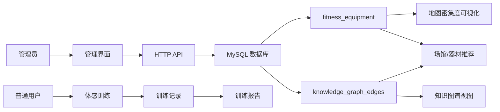
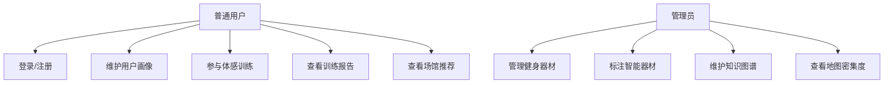
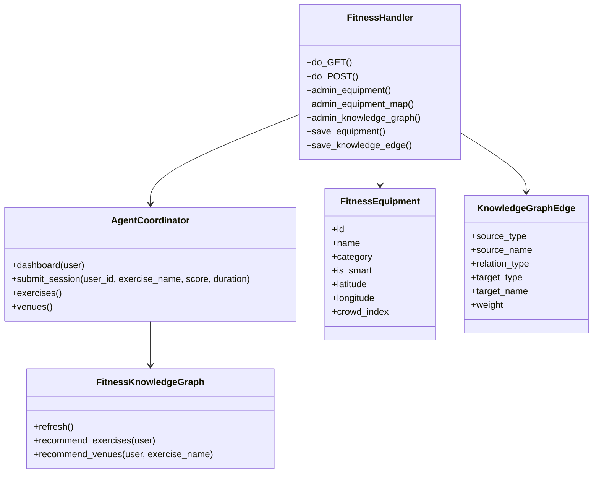
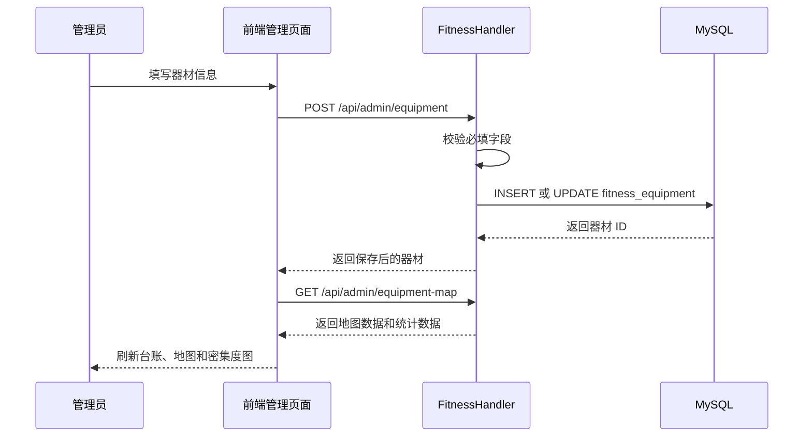
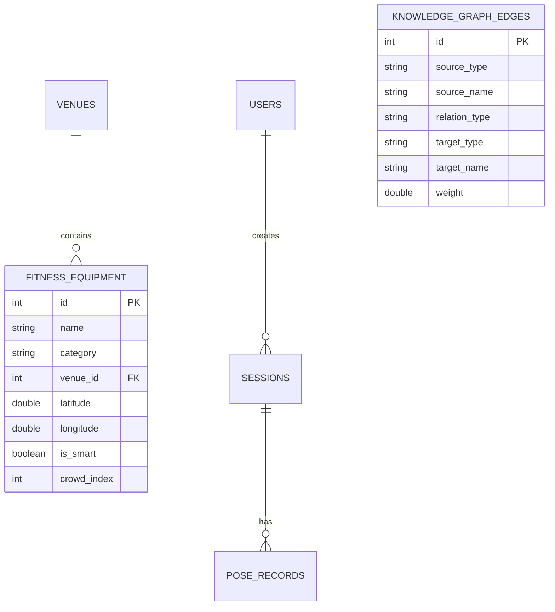

# 虚拟游戏化全民健身智能辅助系统项目文档

## 1. 项目概述

本项目是一个基于多智能体协同的全民健身智能辅助系统，包含用户画像、体感训练、动作评估、场馆推荐、训练报告、管理员器材管理、知识图谱维护、地图密集度可视化等模块。

新增功能聚焦管理员端：

- 管理员可对健身器材进行增删改查。
- 器材可标注是否智能化，并维护状态、厂商、位置、经纬度、维护时间、密集度、使用次数。
- 管理员可维护知识图谱关系，如“器材 supports 动作”“场馆 contains 器材”“器材 suitable_for 人群”。
- 地图使用 Leaflet / OpenStreetMap API 展示器材位置，并以圆点颜色和半径表现人群使用密集度。
- 提供分类密集度条形图、器材台账、知识图谱节点视图。

## 2. 功能模块

| 模块 | 功能 |
| --- | --- |
| 用户画像 | 注册登录、年龄、体能水平、伤病史、偏好、位置录入 |
| 训练关卡 | 选择运动类型，结合 MediaPipe 或键盘演示完成体感训练 |
| 动作评估 | 根据动作分数生成反馈、积分、等级和徽章 |
| 场馆推荐 | 根据位置、器材、拥挤度、空气质量排序推荐 |
| 训练报告 | 汇总训练次数、平均分、薄弱动作、趋势和建议 |
| 管理员器材管理 | 器材 CRUD、智能标注、维护状态、经纬度、使用密集度 |
| 知识图谱维护 | 维护源节点、关系、目标节点、权重和说明 |
| 地图密集度 | 展示器材位置、智能设备、人群密集程度和分类统计 |

## 2.1 角色与页面权限

系统内置两类账号：

| 角色 | 默认账号 | 默认密码 | 登录后界面 |
| --- | --- | --- | --- |
| 普通用户 | `demo` | `123456` | 进入用户首页，可使用训练、场馆推荐、报告、用户画像，看不到管理员端 |
| 管理员 | `admin` | `admin123` | 进入器材管理工作台，可查看用户侧页面，并维护器材、地图密集度和知识图谱 |

权限规则：

- `users.role = user`：只显示普通用户导航，不渲染“器材管理”入口。
- `users.role = admin`：显示“器材管理”入口，并允许访问管理员 API。
- 管理员接口需要携带管理员账号 ID，普通用户直接请求会返回 `403`。

## 3. 接口说明

### 用户与训练接口

| 方法 | 路径 | 说明 |
| --- | --- | --- |
| POST | `/api/register` | 用户注册 |
| POST | `/api/login` | 用户登录 |
| POST | `/api/profile` | 更新用户画像 |
| GET | `/api/dashboard?user_id=1` | 获取首页数据 |
| GET | `/api/exercises` | 获取动作库 |
| GET | `/api/venues` | 获取场馆列表 |
| POST | `/api/session` | 提交训练记录 |
| POST | `/api/pose/record` | 保存姿态识别记录 |

### 管理员接口

| 方法 | 路径 | 说明 |
| --- | --- | --- |
| GET | `/api/admin/equipment` | 查询器材台账 |
| GET | `/api/admin/equipment-map` | 查询地图器材、统计指标、分类密集度 |
| POST | `/api/admin/equipment` | 新增或更新器材 |
| POST | `/api/admin/equipment/delete` | 删除器材 |
| GET | `/api/admin/knowledge-graph` | 查询知识图谱节点和边 |
| POST | `/api/admin/knowledge-graph` | 新增或更新知识图谱关系 |
| POST | `/api/admin/knowledge-graph/delete` | 删除知识图谱关系 |

器材保存示例：

```json
{
  "name": "智能深蹲架 A1",
  "category": "力量训练",
  "venue_id": 1,
  "location": "河北体育馆力量区",
  "latitude": 38.0427,
  "longitude": 114.5149,
  "is_smart": true,
  "status": "normal",
  "manufacturer": "FitFlow Lab",
  "crowd_index": 68,
  "daily_uses": 126,
  "last_maintenance": "2026-05-10",
  "description": "支持姿态识别、次数统计和动作风险提醒。"
}
```

知识图谱关系保存示例：

```json
{
  "source_type": "equipment",
  "source_name": "智能深蹲架 A1",
  "relation_type": "supports",
  "target_type": "exercise",
  "target_name": "深蹲",
  "weight": 0.95,
  "note": "器材可识别膝髋角度，适合力量训练纠错。"
}
```

## 4. 数据库设计

新增核心表：

| 表 | 说明 |
| --- | --- |
| `fitness_equipment` | 健身器材信息、智能标注、经纬度、状态、密集度 |
| `knowledge_graph_edges` | 知识图谱关系边，维护源节点、关系、目标节点和权重 |

关键字段：

- `fitness_equipment.is_smart`：是否智能器材。
- `fitness_equipment.crowd_index`：人群密集度，0 到 100。
- `fitness_equipment.latitude` / `longitude`：地图定位坐标。
- `knowledge_graph_edges.relation_type`：关系类型，如 `supports`、`contains`、`suitable_for`。
- `knowledge_graph_edges.weight`：关系权重，用于推荐排序或图谱推理。

## 5. 数据流



## 6. UML 用例图



## 7. UML 类图



## 8. 时序图：管理员保存器材



## 9. ER 图



## 10. 运行方式

```bash
cd D:\dachuang\virtual-fitness-agent-system\virtual-fitness-agent-system
python app.py
```

浏览器打开：

```text
http://127.0.0.1:8765
```

登录后点击左侧“器材管理”即可进入管理员端。
